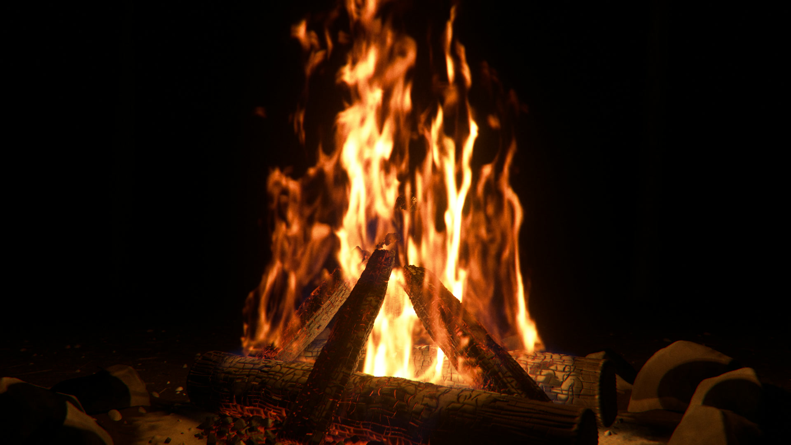

# Procedural Fire

A fully procedural, physically based campfire in WebGPU. Everything you see and hear is computed: no textures,
no images, no sound samples.



Built with Claude Code (Claude Opus 5.5).

- **Simulation** (`src/sim.js`): a 3D low-Mach combustion solver on the GPU (WebGPU compute).
  MacCormack advection, mixing-limited burning of pyrolysis gas with air, gas expansion as a divergence
  source, soot that forms after ~20–60 ms of gas age (which gives the blue flame roots) and burns out at the
  tips, soot radiative cooling, McCaffrey-calibrated buoyancy, vorticity confinement, rising curl-noise
  turbulence, and a multigrid pressure solver with open (entraining) boundaries. Heat release is ~50–60 kW,
  like a real campfire, and the flames puff at roughly 1.5/√D Hz because the units are real (metres, seconds, g).
  For the cinematic, pyrolysis is anchored to separate spots on the logs (distinct tongues with dark gaps), and
  hot-gas viscosity plus age-gated forcing keep the flame base laminar so tongues only wrinkle and break up
  towards the tips.
- **Rendering** (`src/renderer.js`, `src/shaders/scene.js`): a volumetric ray-marcher where flames emit
  Kirchhoff soot radiance `κ·B(T)` from a Planck spectrum integrated against the tabulated CIE 1931 observer,
  with lit smoke, sub-voxel curl-warp detail, an SDF scene (charred logs with glowing alligator cracks,
  coal bed, fire-ring stones, ground) lit by lights extracted from the flame volume itself, burning spark
  particles with energy-conserving motion-blurred streaks, heat haze, bloom, chromatic aberration,
  vignetting, grain and a camera-like per-channel tone curve calibrated against measured photos of real fire
  (`research/visual_reference.md`, `tools/fire_metrics.py`).
- **Sound** (`src/audio/`): procedural campfire audio (roar, breath, hiss, clustered crackles, resin pops,
  log shifts, embers, gusts, outdoor reverb), coupled to the simulation's light output and synced to the sparks.

## Run it

WebGPU is required (Chrome/Edge 113+).

```bash
node tools/server.mjs 8787
```

Open `http://localhost:8787/` and click to light the fire. Drag to orbit, wheel to zoom,
`S` stoke, `P` pop, `G` gust, `H` hide UI, `F` fullscreen. Quality presets: `?q=low|med|high`.

## Render the cinematic

```bash
node tools/render_final.mjs
```

One command for the final 20 s vertical video (1080×1920, 30 fps): it renders the timeline (`src/timeline.js`:
six shots, fire intensity, pops, log shift, gust) on the GPU with true motion blur (90° shutter, sub-frame
accumulation) and thin-lens depth of field, then builds the soundtrack from the per-frame light output and the
same event list, masters it to −14 LUFS / −1 dBTP and muxes `out/video/final_final.mp4`. The final flame and
lens settings are in `FINAL` at the top of `tools/render_final.mjs`.

- `--preview`: 540×960 quick end-to-end check (picture + sound).
- About 3 h on an integrated GPU; on a cloud GPU (RTX 4090) roughly 15–25 min — see `tools/runpod/README.md`.
- `--q cine`: finer 5.4 mm simulation grid for a large GPU (not yet look-tested; compare with `hero` first).

The lower-level tools are `tools/render_video.mjs` (picture only, any settings) and `tools/finish_video.mjs`
(soundtrack + mux for an existing render).

## Tools

- `tools/shot.mjs` — headless deterministic stills, profiling, field statistics and photo metrics.
- `tools/lens_test.mjs` — A/B renders of chosen timeline moments with different sim, lens and render settings
  (fast-forwards the simulation without rendering); `tools/compare.py` builds side-by-side strips.
- `tools/fire_metrics.py` — scores a render against statistics measured on real fire photographs.
- `tools/calib_tonemap.mjs` — checks the tone curve against the measured camera "fire ramp".
- `tools/ui_test.mjs` — smoke test of the interactive viewer.
- `research/` — physics, rendering, audio, visual-reference and WebGPU notes the implementation is based on.
